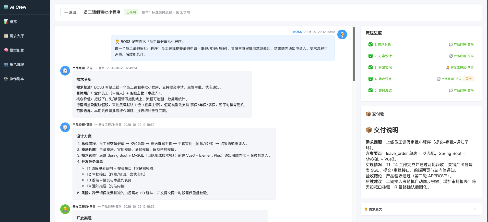
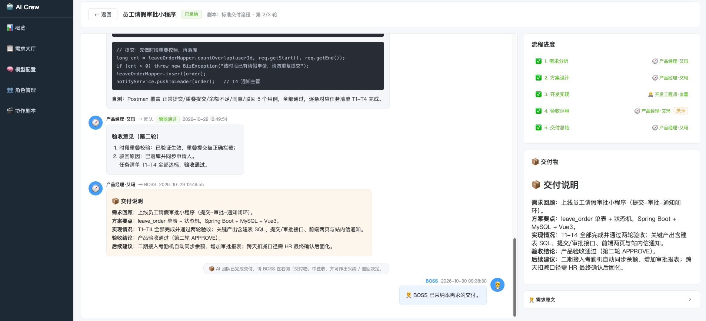

# AI Crew · AI 虚拟协作团队平台

>   AI 角色团队（产品经理、开发工程师…）互相发消息协作：产品经理出方案、开发做实现、产品验收把关，最后交付给你验收。


## 核心点

1. 【模型配置】 若干大模型端点（A 模型、B 模型…） 
2. 【角色管理】创建角色并把**角色绑定到模型** —— 实现"A 模型当产品经理、B 模型当开发"；C、D、E 等任意角色随意加（测试/架构师/数据分析师…），人设可自定义。
3. 【协作剧本】定义流程环节：每步指定执行角色、环节指令；可设**验收关卡**（不通过自动打回返工，限制最大轮数）。
4. 【需求大厅】以 BOSS 身份发布需求 → 进入**作战室**实时围观团队协作（SSE 推送）→ AI 交付后你「采纳 / 退回」。

默认剧本：需求分析 → 方案设计 → 开发实现 → 验收评审（可返工 ≤3 轮）→ 交付总结。

## 技术栈
后端 **Spring Boot 多模块**（Java 17），前端 **Vue3 + Element Plus**，数据库 **H2 文件库（零配置）**，模型接入 **OpenAI 兼容协议**（DeepSeek / GLM / Qwen / OpenAI / 中转站均可）。

## 页面


## 目录结构

```
ai-crew/
├── pom.xml                 # 父工程
├── crew-common/            # 公共：实体、JPA 仓库、枚举、Result、JSON 工具
├── crew-llm/               # 大模型接入：OpenAI 兼容客户端（多模型可配）
├── crew-agent/             # 角色：默认人设模板、Prompt 组装器
├── crew-engine/            # 协作引擎：剧本编排、轮转驱动、验收返工、SSE 推送
├── crew-server/            # Web 启动模块：REST API、SSE、种子数据（端口 8090）
├── ai-crew-web/            # Vue3 前端（Vite，端口 5173）
└── mock/mock-llm.js        # 本地 Mock 模型（无 key 演示全流程，端口 18080）
```

模块依赖：`server → engine → (agent, llm) → common`，替换 LLM 协议只需在 crew-llm 新增一个 `LlmClient` 实现。

## 快速开始

```bash
# 1. 编译后端（JDK 17+）
cd ai-crew
mvn -DskipTests package

# 2. 启动后端（数据落在 ai-crew/data/ 下）
java -jar crew-server/target/crew-server-1.0.0.jar
# 或开发时: mvn spring-boot:run -pl crew-server


# 3. 启动前端
cd ai-crew-web
npm install
npm run dev       
```
#### 打开 http://localhost:5173
### 无 apiKey 先看效果（可选）

```bash
node mock/mock-llm.js                        # 启动 Mock 模型(18080)
# 到「模型配置」把示例角色改绑到「本地 Mock 演示模型」，再发布需求即可
```

### 接入真实模型

到【模型配置】给示例模型填 apiKey（DeepSeek / 智谱 / 硅基流动 任选），或新增自己的端点。要求 `{baseUrl}/chat/completions` 可访问：

| 厂商 | Base URL | 模型示例                       |
|---|---|----------------------------|
| DeepSeek | `https://api.deepseek.com` | `deepseek-chat`            |
| 智谱 GLM | `https://open.bigmodel.cn/api/paas/v4` | `glm-5.3-flash`            |
| 硅基流动 | `https://api.siliconflow.cn/v1` | `Qwen/Qwen2.5-7B-Instruct` |
| OpenAI | `https://api.openai.com/v1` | `gpt-4o-mini`              |

## 协作引擎工作方式

- 每个环节：`角色人设(system) + 环节指令(模板占位符 {title}/{requirement}/{history}/{round}/{maxRounds})` → 调用该角色绑定的模型 → 要求模型只输出 JSON `{"content":"…"[, "verdict":"APPROVE|REJECT"]}`（解析失败自动降级为纯文本，不卡流程）。
- 验收关卡 REJECT → 跳回指定步骤返工，轮次 +1；超过 `maxRounds` 强制交付；最后一步的发言即交付物。
- 全程消息落库 + SSE 推送到作战室；模型调用失败任务标记「已中断」，可点「继续协作」从当前环节恢复。
- BOSS「退回」会带上你的意见从需求分析重新协作一轮。

## 改用 MySQL

`crew-server/pom.xml` 注释掉 H2、放开 mysql-connector-j，`application.yml` 改数据源即可（H2 启动时为 MySQL 模式，字段类型可直接迁移）。

## 后续可扩展

- 模型流式输出（当前按整条消息返回，粒度是「一条发言」）
- 环节间自由讨论轮（@某人追问）、并行环节
- 协作产物落文件（真正生成代码工程）、对接 GitLab MR
- 多剧本按需求类型路由

